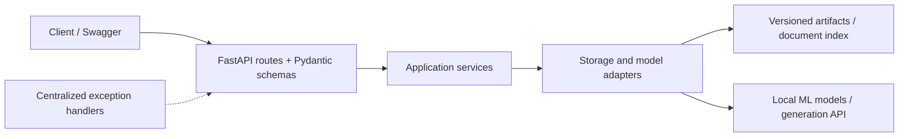
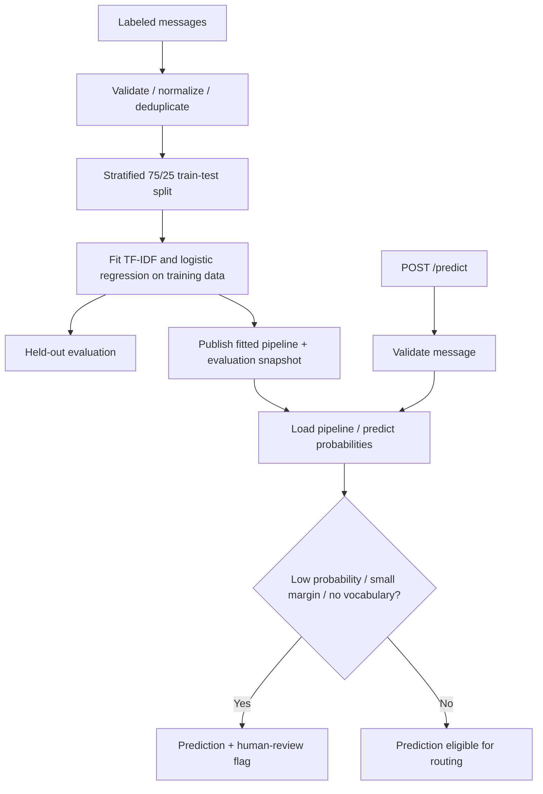
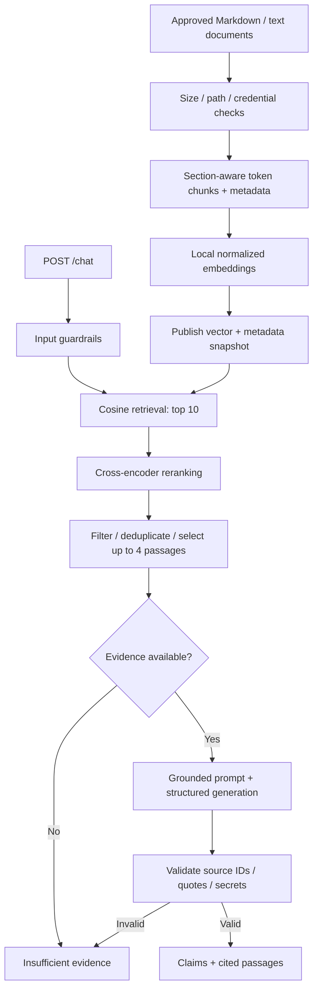

# AI Specialist Assessment

**Selected scenarios: customer support classification and an engineering document chatbot.** Both are implemented as independent FastAPI services with modular code, typed API contracts, centralized exception handling, Docker configuration, and test files.

| Scenario | Approach | Main behavior |
| --- | --- | --- |
| 1: Support classification | TF-IDF + logistic regression | Predict billing, technical issue, or general inquiry; flag uncertainty for human review |
| 2: Engineering chatbot | Semantic retrieval + cross-encoder reranking + grounded generation | Answer using document evidence and citations; abstain when evidence cannot be validated |

**Submission status:** code, tests, and configuration are provided. They have not been executed; no measured accuracy or performance is claimed. Sample messages are synthetic and engineering documents are fictional. All documentation is in this file.

## Contents

- [Setup and API access](#setup-and-api-access)
- [Code architecture](#code-architecture)
- [Scenario 1: Customer support classification](#scenario-1-customer-support-classification)
- [Scenario 2: Engineering chatbot](#scenario-2-engineering-chatbot)
- [Error handling](#error-handling)
- [Tests and evaluation](#tests-and-evaluation)
- [Gaps before production](#gaps-before-production)

## Setup and API access

Prerequisites: Docker with Compose and internet for dependency/model downloads. Only chatbot generation needs an OpenAI API key. The key remains a placeholder in this submission.

```sh
# From the repository root:
cp .env.example .env
# Set OPENAI_API_KEY in .env only if running chatbot generation.
docker compose up --build
```

PowerShell: replace the first command with `Copy-Item .env.example .env`.

| Service | Swagger documentation | First-use sequence |
| --- | --- | --- |
| Classifier | http://localhost:8001/docs | `POST /train`, then `POST /predict` |
| Chatbot | http://localhost:8002/docs | `POST /ingest`, then `POST /retrieve` or `POST /chat` |

Classifier alone: `docker compose up --build classifier`. Stop with `docker compose down`; named volumes retain models, indexes, and downloaded weights. Local models load lazily on ingestion/retrieval. Cached weights allow local retrieval without model downloads; generation still requires API access. Package/model compatibility and Docker builds remain unverified.

## Code architecture



Each scenario has the same directory structure:

```text
scenario_1_classification/       scenario_2_chatbot/
    app.py                          app.py
    src/                            src/
        api/                            api/
        core/                           core/
        schemas/                        schemas/
        services/                       services/
        infrastructure/                 infrastructure/
    tests/                          tests/
    data/                           data/documents/
    evaluation/                     evaluation/
    Dockerfile                      Dockerfile
    requirements.txt                requirements.txt
    requirements-dev.txt            requirements-dev.txt
```

| Layer | Responsibility |
| --- | --- |
| `app.py` | Application factory, lifecycle, routes, and exception-handler registration |
| `api/` | Thin HTTP routes and dependency injection |
| `core/` | Validated environment configuration and typed application errors |
| `schemas/` | Requests, responses, predictions, passages, claims, and evidence |
| `services/` | Business workflows: training/prediction or ingestion/retrieval/chat |
| `infrastructure/` | CSV/document loading, artifact/index persistence, model/provider adapters |
| `tests/` | Isolated workflow, failure-handling, and API contract tests |

Snapshots are immutable; an atomic pointer replacement publishes a complete model/index version. Readers keep one consistent version during an update. Failed publication preserves the previous active version but may leave orphan files. Process-local locks protect training/ingestion and local model inference; they do not coordinate multiple writers across workers.

## Scenario 1: Customer support classification

### Flow



### Technology choices

| Technology | Why chosen |
| --- | --- |
| Python 3.11 / FastAPI / Pydantic / Uvicorn | Typed REST service with interactive Swagger documentation |
| scikit-learn TF-IDF, word unigrams/bigrams | Interpretable baseline capturing phrases such as password reset |
| Balanced logistic regression | Fast supervised classifier with probability estimates and no generative API cost |
| pandas / joblib | Data validation and persistence of vectorizer/model together |
| Docker / Compose | Independent service with persistent artifacts |

Start with this baseline and compare semantic embeddings or a fine-tuned transformer on the same held-out data if paraphrases or multilingual coverage require them. An LLM classifier offers flexible intent rules but adds provider cost, latency, and privacy considerations.

### Data, preprocessing, and uncertainty

- **Needed data:** historical messages with agent-confirmed labels, timestamps, language, and ticket/thread IDs. Use annotation guidelines and adjudicate disagreements. Redact sensitive identifiers and split related threads together; use a later time window for the final test.
- **Included data:** [48 synthetic messages](scenario_1_classification/data/messages.csv), 16 per category. These demonstrate format, not real-world quality.
- **Preprocessing:** reject empty/oversized messages, lowercase, normalize whitespace, detect conflicting duplicate labels, and remove exact duplicates before splitting. Preserve negations, numbers, and error codes; the TF-IDF tokenizer still separates punctuation and excludes single-character tokens.
- **Training:** fit vocabulary on training data only; use balanced class weights and a reproducible split. There is no hyperparameter search in this demonstration.
- **Review routing:** flag probability below **0.65**, top-two margin below **0.15**, or zero recognized vocabulary. Thresholds are illustrative and need validation/calibration; probabilities are not guaranteed confidence.
- **Assumptions and risks:** one dominant English intent. Mixed-intent, unfamiliar, or non-English messages can be misclassified even with high scores. General inquiry is a defined product/service category, not a universal fallback.

### API and evaluation

| Endpoint | Purpose |
| --- | --- |
| `GET /health` | Process status and model-pointer presence |
| `POST /train` | Train bundled data, publish version, return evaluation |
| `POST /predict` | Return category, probabilities, margin, and review decision |

```json
{"message":"I was charged twice for my subscription"}
```

Prediction fields: `predicted_category`, `model_probability`, `probabilities`, `top_two_margin`, `needs_human_review`, and `review_reasons`.

Training reports accuracy, per-class precision/recall/F1, macro F1, confusion matrix, misclassified examples, review rate, coverage, and accepted-prediction accuracy. Accepted accuracy is null when all messages are reviewed. Reports live under `artifacts/<version>/evaluation.json`. Use a separate validation partition for thresholds and preserve final test data. Track coverage alongside accuracy so excessive review does not hide weak automation. [Manual edge cases](scenario_1_classification/evaluation/review_cases.json) include mixed intent and unknown vocabulary.

## Scenario 2: Engineering chatbot

### Flow



### Technology choices

| Technology | Why chosen |
| --- | --- |
| Python 3.11 / FastAPI / Pydantic | Typed API and structured grounding contracts |
| `sentence-transformers/all-MiniLM-L6-v2` | Local semantic embeddings for a small English corpus |
| NumPy normalized vector matrix | Exact cosine search without a separate database; inspectable prototype |
| `cross-encoder/ms-marco-MiniLM-L-6-v2` | Joint question/passage scoring on a small candidate set |
| OpenAI Responses API | Structured claim/evidence generation with configurable model and key |
| Docker / Compose | Separate service with persistent index and model cache |

Default generation model: `gpt-4o-mini`, configurable via `OPENAI_MODEL`; this is an example selection, not a verified performance recommendation. The structured-output integration follows the [official OpenAI documentation](https://developers.openai.com/api/docs/guides/structured-outputs). Structured format does not establish factual accuracy.

### Ingestion and retrieval decisions

| Setting | Implementation and rationale |
| --- | --- |
| Document types | Curated UTF-8 Markdown/text, up to 1 MB per file; no PDF/OCR support |
| Chunking | Section boundaries; default 180 body tokens, 30-token overlap; cap to encoder limit and reserve title space to avoid truncation |
| Metadata | Relative document path, section, and content-derived chunk ID for traceability |
| Initial retrieval | Top 10 cosine candidates to give reranking multiple options |
| Reranking | Cross-encoder relevance logits; illustrative minimum score 0.0 |
| Final context | Up to 4 passages, exact text deduplication, 12,000-character text cap |
| Updates | Explicit full rebuild through `/ingest`; embedding-model name changes require rebuild |

Tune chunking, top-k, and threshold on validation questions. Relevance logits are not calibrated probabilities and cannot prove answerability. The character cap is not a precise generation-token budget. Tokenizer decoding may normalize formatting; quotes are validated against stored passages. Exact search reloads vectors per request and costs O(chunks × dimensions); larger corpora need caching and potentially approximate/hybrid search. Snapshot retention, automatic freshness detection, and incremental updates are not implemented.

### Prompt and guardrails

The [system prompt](scenario_2_chatbot/src/services/prompts.py) defines an engineering-only assistant, requires answers exclusively from supplied evidence, treats document/question instructions as untrusted, prohibits invented procedures, and requests abstention for missing, ambiguous, or conflicting evidence. No command-execution tools are exposed. Question and passages are serialized as lower-priority JSON input.

| Stage | Implemented control | Remaining limitation |
| --- | --- | --- |
| Input | Length/whitespace validation, known secret patterns, obvious instruction-override rejection | Regex checks miss paraphrased attacks and unknown credential formats |
| Ingestion/retrieval | Reject detected credentials before embedding or passage disclosure | No complete PII detector or document authorization layer |
| Evidence selection | Relevance filtering, bounded context, no-context abstention | Relevant passages can still lack the answer |
| Generation | Evidence-only prompt and structured claims with per-claim citations | Model may misinterpret evidence or miss conflicts |
| Output | Source membership, exact supporting quote, claim limits, secret checks | Existing quotes do not prove semantic entailment |
| Failure | Invalid/refused/unparsed answers withheld; provider failures return service errors | Hallucination reduction is not a guarantee |

These controls reduce unsupported generation. Independent claim-entailment verification and adversarial evaluation remain production requirements. `store=False` requests no stored response state; it is not a zero-retention guarantee. Questions/passages still leave the service for generation, so provider privacy review is required for internal data.

### API and evaluation

| Endpoint | Purpose |
| --- | --- |
| `GET /health` | Process status and index-pointer presence |
| `POST /ingest` | Build and publish an index version |
| `POST /retrieve` | Inspect selected passages and scores without generation/API key |
| `POST /chat` | Return validated claims with sources or abstain |

```json
{"question":"When should we roll back a release?"}
```

Answered output includes `status`, `claims[].text`, `claims[].evidence[]` with source IDs/quotes, and cited `sources[]`. Abstention returns a fixed message and empty claims/sources. An unrelated question may yield out-of-scope or insufficient-evidence status depending on retrieval. The [fictional documents](scenario_2_chatbot/data/documents) specify the intended example answer; no response has been measured.

Use engineer-authored questions with reference supporting passages. Measure retrieval recall@10, reranked recall@4/MRR, answer correctness, semantic claim support, citation validity, appropriate abstention, attack bypasses, latency, memory, and API cost. Compare retrieval with and without reranking. Separate tuning questions from the final test set. [Evaluation cases](scenario_2_chatbot/evaluation/cases.json) include supported questions, missing information, ambiguity, and injection attempts.

## Error handling

Both services return a consistent `{code, message, request_id}` envelope with `X-Request-ID`. Infrastructure adapters translate filesystem and provider failures into typed application exceptions. Central handlers sanitize expected and unexpected failures; logs omit raw provider errors, keys, document content, and customer questions.

| HTTP status | Meaning |
| --- | --- |
| 400 | Invalid/blocked input or invalid training/documents |
| 409 | Model/index not ready or embedding configuration mismatch |
| 422 | Request does not match the API schema |
| 502 | Local model or generation-provider failure |
| 503 | Storage failure or missing generation-key configuration |
| 500 | Unexpected failure with generic public message |

Health endpoints indicate process/artifact presence, not full provider readiness or artifact integrity. Joblib files must be trusted: deserialization can execute code. HTTP endpoints accept no arbitrary model uploads or filesystem paths.

## Tests and evaluation

Tests are **written, not executed**. These commands are provided for future verification:

```sh
docker compose run --rm classifier sh -c "pip install -r requirements-dev.txt && pytest"
docker compose run --rm chatbot sh -c "pip install -r requirements-dev.txt && pytest"
```

| Service | Test coverage |
| --- | --- |
| Classifier | Training-only vocabulary, conflicting/missing labels, no-vocabulary review, small-margin routing, artifact snapshots, sanitized API errors |
| Chatbot | Chunk overlap, document validation, snapshot integrity/failed publication, reranking/filtering, fabricated citations, abstention, credential rejection, provider errors, API contracts |

Chatbot tests use model/provider doubles and need no API key or downloaded model weights. Execute suites separately because each service has its own local `src` package. Unit/API tests verify behavior; representative quality evaluation and load tests are additional requirements.

## Gaps before production

| Area | Classifier | Chatbot |
| --- | --- | --- |
| Data | Real adjudicated labels, privacy redaction, group/time splits | Approved corpus, ownership/freshness, PII redaction, source permissions |
| Quality | Calibrated scores, validated thresholds, mixed-intent/language handling | Tuned retrieval settings, semantic claim verification, stronger injection defenses |
| Access | Authentication and admin-only training | Authentication, admin-only ingestion, authorization before retrieval, provider privacy review |
| Scale | Background training, version-aware model cache, review capacity | Background ingestion, cached indexes, batching/queues, rate limits, approximate/hybrid retrieval |
| Operations | Drift monitoring, feedback, retraining, approved model promotion | Corpus/index monitoring, version/revision manifests, snapshot retention |
| Verification | Dependency locks, execution checks, load tests | Dependency/model revision locks, API compatibility checks, load/adversarial tests |

The assessment includes modular implementation, documentation, and test specifications. Production readiness depends on completing these validation and operational steps.
